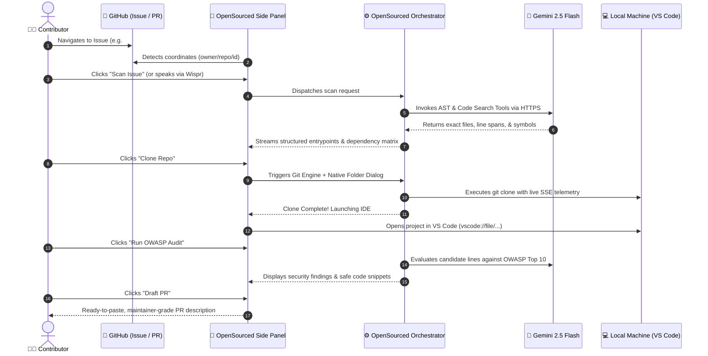

# 🚀 OpenSourced — Ambient GitHub App & Onboarding Engine

> **The Ambient, Context-Aware Co-Pilot for Open-Source Contributors and Maintainers.**  
> Turn complex 100k+ line repositories into solvable issues in seconds. Zero copy-pasting, AST-precision symbol maps, 1-click & voice-driven local workspace bootstrapping, and pre-flight OWASP security audits.

---

---

## 💡 Why OpenSourced?

Contributing to open-source software is one of the most rewarding ways to grow as an engineer, yet the onboarding barrier remains frustratingly high:

1. **Context Fragmentation:** You land on a `good first issue` in a massive codebase (like Cal.com, Supabase, or Next.js) and have no idea which files are actually involved.
2. **Chatbot Fatigue:** General-purpose AI chatbots force you to manually copy-paste issue descriptions, file paths, and snippets into a blank chat box while losing your place in GitHub.
3. **Workspace Setup Friction:** Finding the clone URL, switching to your terminal, picking directories, and remembering command-line flags wastes time.
4. **Security Anxiety:** First-time contributors dread submitting pull requests that inadvertently introduce security flaws or regressions.

**OpenSourced solves this by turning GitHub into an interactive, ambient workbench.** The OpenSourced GitHub App connects seamlessly with your workflow to eliminate manual overhead, analyze issue entry points with compiler-level precision, clone code locally in one click or spoken sentence, and safeguard your contributions before you even write your first line of code.

---

## ✨ Cool Functionalities & Core Superpowers

### 1. 🔍 Zero-Copy GitHub Context Auto-Detection
*No more copy-pasting issues into external chat boxes.*
- The moment you view any GitHub Issue or Pull Request, OpenSourced automatically extracts the repository coordinates (`owner`, `repo`, `issueNumber`), labels, body, and discussion thread.
- Tracks GitHub SPA transitions in real-time, instantly adjusting context as you browse from issue to issue.

---

### 2. 🎯 AST & Matrix Syntax Tree Precision (Zero-Hallucination Entrypoints)
*Compiler-grade accuracy instead of fuzzy guessing.*
- Traditional LLMs guess file names and invent non-existent functions. OpenSourced leverages **Abstract Syntax Tree (AST) parsing** and structural code querying.
- Returns **exact file paths, line ranges, class interfaces, exported functions, and dependency matrices**.
- Understands how components interconnect across imports without blowing up context windows or losing precision.

---

### 3. 🚀 1-Click & Voice-Driven Local Workspace Bootstrapping
*From GitHub tab to local VS Code in seconds.*
- **Native OS Folder Picker:** Choose where to clone your project using your operating system's native folder dialog (`~/Projects`, `/Developer`, etc.).
- **Live SSE Streaming Progress:** Watch git clone objects, deltas, and checkout progress stream live inside your browser view.
- **Instant IDE Launch:** Click once (or speak) to instantly open the cloned repository in VS Code via `vscode://file/<path>`.
- **Environment Auto-Detection:** Automatically detects package managers (`npm`, `pnpm`, `yarn`, `bun`, `cargo`, `pip/poetry`) to suggest bootstrap commands.

---

### 4. 🛡️ Pre-Flight OWASP Top 10 Security Audit
*Ship pull requests with enterprise-grade confidence.*
- Before you begin modifying code, OpenSourced performs an automated pre-flight security scan on the candidate entry points.
- Checks against the **OWASP Top 10** risks (Injection, Broken Access Control, Sensitive Data Exposure, SSRF, Identification/Authentication Failures).
- Provides concrete line-numbered vulnerability warnings, CWE identifiers, severity ratings (`CRITICAL` to `INFORMATIONAL`), and battle-tested mitigation snippets.

---

### 5. 🎙️ Wispr Flow "No Hands" Voice Integration
*Code at the speed of thought without touching the keyboard.*
- Built for accessibility and ultra-fast navigation powered by **Wispr Flow**.
- Speak natural workflow commands:
  - *"Clone repo to my projects folder"*
  - *"Scan issue and find entrypoints"*
  - *"Run security audit on the auth controller"*
  - *"Draft a pull request description"*
  - *"Export report to Google Drive"*
- Dictate custom constraints, hints, or debugging thoughts directly into the reasoning engine.

---

### 6. 📝 Automated, Maintainer-Friendly Pull Request Generator
*Write pull request descriptions that maintainers love to review.*
- Synthesizes the original issue requirements, identified code entry points, and applied fixes into an industry-standard PR template.
- Automatically includes:
  - `Closes #<issue_id>` linking
  - Concise summary of architectural changes
  - Step-by-step verification and testing instructions
  - Code hygiene and security checklist
- 1-click **"Copy to Clipboard"** in GitHub-flavored Markdown.

---

### 7. ☁️ Instant Google Drive & Local Markdown Research Artifacts
*Keep your onboarding notes organized forever.*
- One-click export of research findings, AST dependency maps, and security notes directly into your personal Google Drive (strictly scoped to `drive.file` for privacy).
- **Zero-Auth Local Fallback:** No cloud account needed? Download a clean, standalone `.md` report or copy findings with a single click.

---

### 8. ⚡ Strategy-Driven AI Reasoning Core
*Powered by Google Gemini 2.5 Flash.*
- Leverages Google Gemini’s high-velocity function calling, large context window, and native JSON mode.
- Built on a modular **Strategy Pattern**—future-ready for local offline models (Ollama) or private enterprise endpoints.

---

## 🔄 How It Works: The Contributor Workflow

---

## 🆚 OpenSourced vs. Generic Chatbots

| Capability | Generic Chatbots (ChatGPT / Copilot Chat) | 🚀 OpenSourced GitHub App |
| :--- | :--- | :--- |
| **Context Acquisition** | Manual copy-pasting of issue text & files | **Zero-Copy Ambient Auto-Detection** |
| **Code Accuracy** | Fuzzy guesses and frequent hallucinated paths | **AST & Matrix Syntax Tree Precision** |
| **Workspace Setup** | Requires manual terminal commands & paths | **1-Click / Spoken Clone + VS Code Launch** |
| **Security Scanning** | Generic or non-existent pre-commit checks | **Pre-Flight OWASP Top 10 Audit** |
| **Hands-Free Control** | Keyboard & mouse only | **Wispr Flow "No Hands" Voice Dictation** |
| **Export Formats** | Raw chat text | **Google Drive Docs & Clean Local Markdown** |
| **Workflow Philosophy** | Open-ended chat with prompt engineering | **Context-Bound 1-Click Action Cards** |

---

## 🔒 Permissions & Security Transparency

OpenSourced is built strictly following the principle of **least privilege**. As a modern GitHub App, we utilize fine-grained permissions and short-lived user-to-server tokens (`ghu_...`) that automatically expire and rotate every 8 hours.

Here is why each permission is requested:

| Permission | Access Level | Why We Need It |
| :--- | :--- | :--- |
| **Repository Contents** | `Read-only` | Needed to fetch file trees, AST interfaces, and code slices for the active issue. |
| **Issues** | `Read-only` | Needed to analyze the issue description, reproduction steps, labels, and community comments. |
| **Pull Requests** | `Read & Write` | Needed to draft pull request descriptions linked to resolved issues and inspect PR diffs. |
| **Metadata** | `Read-only` | Required by GitHub for basic repository identification (stars, default branch, language). |

### Our Privacy Pledge
- 🛡️ **Zero Token Leakage:** GitHub user access tokens are encrypted at rest using AES-256-GCM and never exposed to client-side scripts.
- 🧹 **Entropy & Credential Filtering:** Active Shannon-entropy filters prevent credentials or private keys from ever entering AI prompts or exported documents.
- 🚫 **No Code Storage:** OpenSourced does not store, index, or train on your private code. Files are inspected transiently in-memory during active sessions.

---

## 🚀 Getting Started in 60 Seconds

### Step 1: Install the GitHub App
Click **Install** on the OpenSourced GitHub App page. You can choose to grant access to:
- **All repositories**, or
- **Only select repositories** you plan to contribute to.

> *Note: For public open-source repositories, OpenSourced can inspect public issues and code with standard read permissions without requiring the target repository maintainer to install the app!*

### Step 2: Open the Chrome Side Panel
1. Install the **OpenSourced Chrome Extension**.
2. Navigate to any GitHub repository, issue, or pull request (e.g. `https://github.com/facebook/react/issues/1234`).
3. The OpenSourced panel automatically appears in your Chrome Side Panel, pre-loaded with issue telemetry.

### Step 3: Accelerate Your Contribution
1. Click **Scan Issue** to discover the exact files and lines to modify.
2. Click **Clone Repo** to pull the code to your computer and open VS Code.
3. Click **Run OWASP Audit** to check security entry points.
4. Make your changes, then click **Draft PR** to create your pull request description!

---

## 💬 Community & Feedback

- 🐛 **Found a bug or have a feature idea?** Open an issue on our [GitHub Repository](https://github.com/virTripathi/opensourced/issues).
- 💡 **Join the Discussion:** Connect with other open-source contributors in our [Discussions Tab](https://github.com/virTripathi/opensourced/discussions).
- 📜 **Documentation:** Full technical specifications and architecture blueprints are available in the [`docs/`](file:///Users/virattripathi/myprojects/opensourced/docs) directory.

---

  <b>Built with ❤️ for open-source contributors everywhere.</b> 
  Empowered by Google Gemini & Wispr Flow.

