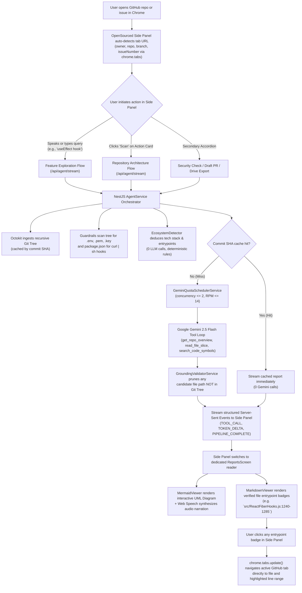

# OpenSourced

> **Explore any codebase in seconds. No cloning required.**  
> OpenSourced turns GitHub into a split-pane workbench. Browse source code on the left, query architecture and features in the Chrome side panel on the right, and click any entrypoint to jump directly to the code.

---

[](#quick-start)
[](#permissions--security-transparency)
[](#how-it-works)
[](#built-with-wispr-flow)
[](LICENSE)

---

## The Problem: The "Clone-or-Blind" Dilemma

When evaluating an unfamiliar open-source project or investigating a complex feature on GitHub:

* **Desktop IDE Overkill:** Understanding how a specific capability works (e.g., how `useEffect` registers hooks in React, or how token refresh is handled in Supabase) usually forces you to clone gigabytes of code, install dependencies, and open an IDE just to browse for five minutes.
* **Disconnected AI Chatbots:** External tools like ChatGPT or Claude live in separate tabs. They cannot see the active repository tree, frequently hallucinate nonexistent files, and cannot interact with your browser.
* **Lost in the Codebase Maze:** Large repositories contain hundreds of nested directories and thousands of files. Finding where a feature actually begins requires endless manual searching.

---

## The Solution: The Split-Pane GitHub Workbench

OpenSourced eliminates the clone-or-blind trade-off by running directly alongside GitHub in the Chrome Side Panel:

```
┌──────────────────────────────────────────────┬──────────────────────────────────────────────┐
│             Active GitHub Tab                │            OpenSourced Side Panel            │
│                 (Left Pane)                  │                 (Right Pane)                 │
├──────────────────────────────────────────────┼──────────────────────────────────────────────┤
│                                              │  [ Context: facebook/react (main) ]          │
│  facebook/react                              │                                              │
│  ├── packages/                               │  Search: "How does useState work?"           │
│  │   └── react-reconciler/                   │                                              │
│  │       └── src/ReactFiberHooks.js          │  [ Interactive Mermaid Sequence Diagram ]    │
│  │                                           │  ↳ Dispatcher -> mountState -> Fiber WorkLoop│
│  │   1240: function mountState(initialState){│                                              │
│  │   1241:   var hook = mountWorkInProgressHook();   [ Verified Entrypoints ]               │
│  │   ...                                     │  ↳ ReactFiberHooks.js:1240-1285 (Click) ----│
│  │                                           │                                              │
│  (Tab automatically highlights line 1240) <--│-- [ Synchronized Browser Navigation ]        │
└──────────────────────────────────────────────┴──────────────────────────────────────────────┘
```

You query any feature or issue directly from the side panel. OpenSourced analyzes the real Git tree, renders an interactive visual sequence diagram, and gives you verified entrypoints. Click any file badge, and your GitHub tab on the left jumps straight to that exact file and line number.

---

## Key Capabilities

### 1. Zero-Copy Ambient GitHub Context
No copy-pasting required. The side panel automatically locks onto the active repository coordinates (`owner`, `repo`, active `branch`, and optional `issueNumber`) as you browse GitHub tabs and SPA transitions.

### 2. Feature Deep-Tracing & Code Grounding
Dictate or type any question (e.g., *"useState hook"*, *"router middleware dispatch"*, *"webhook signature validation"*). OpenSourced analyzes candidate paths from the repository tree and traces the execution flow.

### 3. Interactive Mermaid Sequence & Architecture Diagrams
Visualizes multi-step dataflow and component lifecycles in clean, interactive Mermaid diagrams (`sequenceDiagram` and flowcharts) with pan and zoom controls.

### 4. Spoken Audio Diagram Walkthroughs
Includes a built-in diagram narrator powered by natural browser speech synthesis. Listen to a clear, spoken walkthrough of the system architecture while inspecting the diagram.

### 5. Synchronized Click-to-Jump Navigation
Every discovered code entrypoint renders as an interactive badge with its verified line span (e.g., `src/ReactFiberHooks.js:1240-1285`). Clicking the badge commands the active GitHub tab to navigate directly to that file and highlight the line range (`chrome.tabs.update`).

### 6. Git Tree Anti-Hallucination Grounding
All candidate file paths returned by the AI are strictly validated against the live repository Git tree. Any hallucinated paths are automatically pruned before you see them.

### 7. Deterministic Setup & Hygiene Checks
Automatically deduces the programming language, package manager, monorepo tooling, and run commands from project manifests without relying on AI guesswork. Scans the file tree for committed secrets (`.env`, `.pem`, `id_rsa`) and flags suspicious package lifecycle hooks.

### 8. Pull Request Description Drafter
Synthesizes issue context, candidate files, and suggested verification steps into a structured markdown PR template with testing checklists, ready for 1-click **"Copy to Clipboard"**.

### 9. Local Markdown & Google Drive Artifact Export
Download full-height analysis reports directly as clean, standalone `.md` files or export session research artifacts directly into a dedicated `OpenSourced Research` folder in Google Drive (using strictly scoped `drive.file` permissions).

---

## OpenSourced vs. Generic Chatbots

| Capability | Generic Chatbots (ChatGPT / Copilot Chat) | 🚀 OpenSourced Side Panel |
| :--- | :--- | :--- |
| **Workflow Format** | External disconnected tab | **Split-Pane Browser Side Panel alongside GitHub** |
| **Context Acquisition** | Manual copy-pasting of issue text & URLs | **Zero-Copy Ambient Auto-Detection** |
| **Navigation** | None (manual searching required) | **Synchronized Click-to-Jump (`chrome.tabs.update`)** |
| **Diagrams & Visuals** | Unstructured text replies | **Interactive Mermaid Diagrams with Audio Walkthroughs** |
| **File Path Accuracy** | Frequent hallucinations of non-existent files | **Grounded against live Git Tree (hallucinations pruned)** |
| **Local Overhead** | Requires cloning repo to verify claims | **Zero-Setup In-Browser Architectural Triage** |

---

## Permissions & Security Transparency

OpenSourced follows the principle of **least privilege**. As a modern GitHub integration, we utilize short-lived user tokens that automatically rotate.

| Permission | Access Level | Why We Need It |
| :--- | :--- | :--- |
| **Repository Contents** | Read-only | Needed to fetch repository trees, manifests, and file slices for architectural analysis. |
| **Issues & Discussions** | Read-only | Needed to read issue descriptions and maintainer discussion comments for context. |
| **Metadata** | Read-only | Standard GitHub permission to access basic repository information (stars, default branch). |
| **Pull Requests** | Read-only | Needed to read pull request descriptions when browsing PR tabs. |

---

## How It Works



---

## Repository Structure

OpenSourced is organized as a lightweight Turbo monorepo:

```
opensourced/
├── apps/
│   ├── backend/        # NestJS orchestrator, GitHub API tools, Gemini quota scheduler, SSE streaming
│   └── extension/      # Chrome MV3 Side Panel (React 18, Tailwind, Mermaid.js, Web Speech)
├── packages/
│   └── common/         # Shared TypeScript contracts, DTOs, and ecosystem rules
├── scripts/            # Chrome Extension packaging utility for release ZIPs
├── render.yaml         # Render blueprint for cloud deployment + persistent SQLite volume
└── index.html          # Web landing and overview page
```

---

## Quick Start

### Prerequisites
* Node.js `>= 20.0.0`
* Google Gemini API Key ([get one at Google AI Studio](https://aistudio.google.com/))
* Google Chrome browser (v116+ with Side Panel support)

### 1. Clone & Install Dependencies
```bash
git clone https://github.com/virTripathi/opensourced.git
cd opensourced
npm install
```

### 2. Configure Environment
Copy `.env.example` to `apps/backend/.env` and provide your Gemini API key:
```bash
cp .env.example apps/backend/.env
# Set GEMINI_API_KEY=your_key_here in apps/backend/.env
```

### 3. Run Test Suites & Build
```bash
# Run unit & integration test suites
npm run test

# Build all monorepo packages and extension
npm run build
```

### 4. Load the Chrome Extension
1. Open Google Chrome and navigate to `chrome://extensions`.
2. Enable **Developer mode** (toggle in the top-right corner).
3. Click **Load unpacked** and select the `apps/extension/dist` folder.
4. Open any GitHub repository (e.g., `https://github.com/facebook/react`) and click the OpenSourced extension icon to open the Side Panel.

### 5. Packaging the Extension (for Testers / Releases)
To generate a standalone ZIP for external sideloading:
```bash
npm run package:extension
# Generates opensourced-extension.zip in the root directory
```

---

## Built with Wispr Flow

OpenSourced was built for the **WeMakeDevs × Wispr Flow "No Hands" Challenge** (Builders Track).

Throughout development, **Wispr Flow** was used hands-free to dictate architectural specifications, prompt templates, bug investigations, and documentation directly into the development workflow. The side panel's exploration bar is designed as a direct dictation target—letting you speak complex queries like *"How does useEffect register hook flags in the reconciler"* hands-free using Wispr Flow on macOS and Windows.

---

## License

Distributed under the MIT License. See [`LICENSE`](LICENSE) for details.
